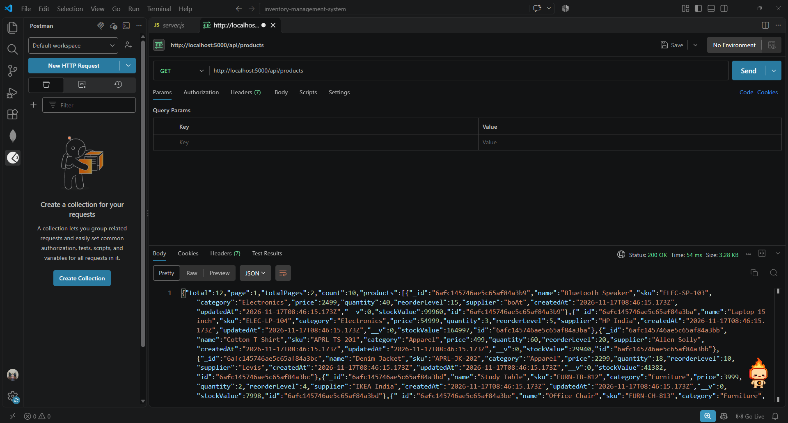
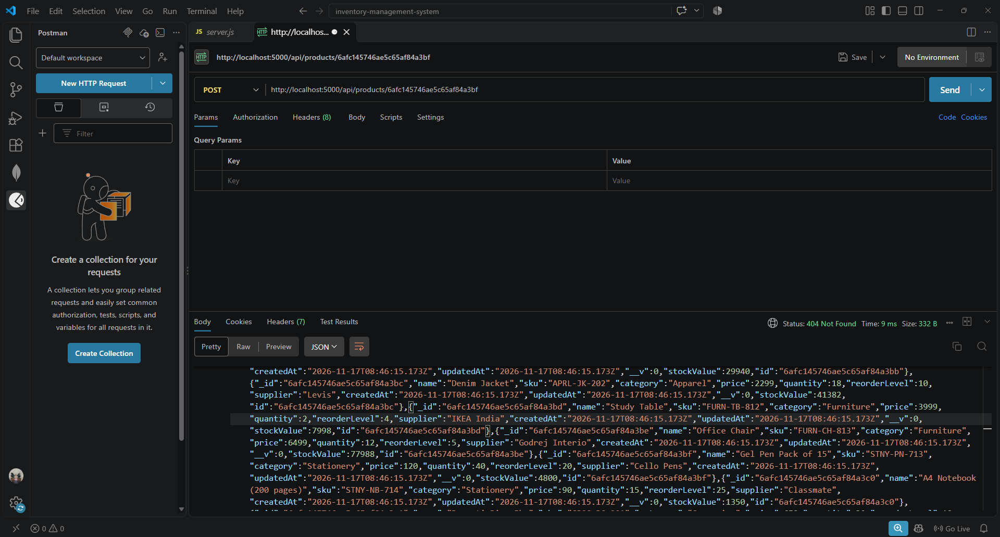
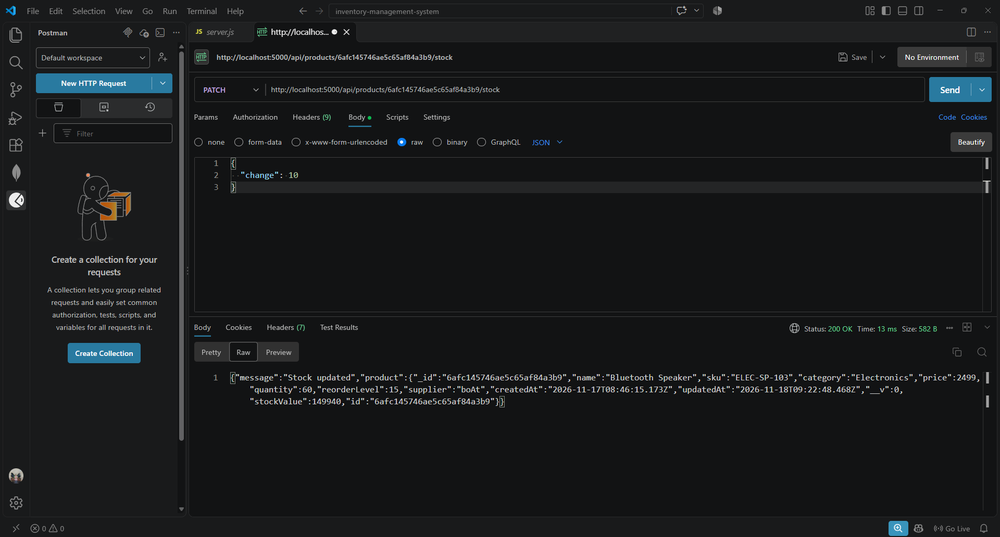
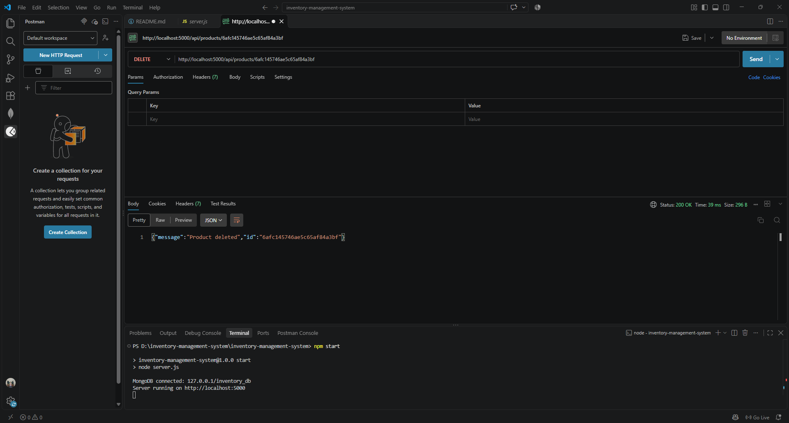
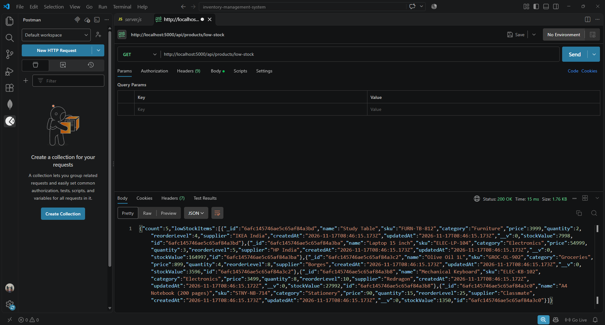
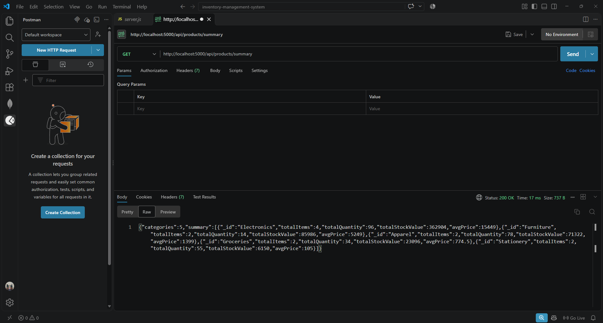
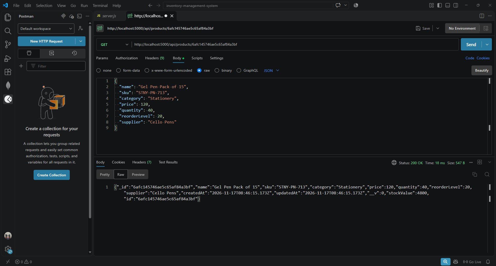

# Inventory and Data Management System

REST API for managing a store/warehouse product catalogue, built with **Node.js, Express, MongoDB (Mongoose) and dotenv** (Web Dev III - Assignment 3).

## Features
- Mongoose schema with field-level validation (required, min/max, enum, regex, integer checks, unique SKU)
- Full CRUD for products
- Filtering, sorting and pagination via query strings
- Safe, atomic stock adjustment (restock / sale) - quantity can never go negative
- Aggregation reports: low-stock alerts and category-wise summary
- Centralized error handling + ObjectId validation middleware
- Environment variables via dotenv

## Project Structure
```
config/db.js                    MongoDB connection
models/Product.js               Schema, validation, stockValue virtual
controllers/productController.js
routes/productRoutes.js
middleware/errorHandler.js      404 + centralized error handler
middleware/validateObjectId.js
utils/                          AppError, asyncHandler
seed.js                         Sample data (12 products, 5 categories)
server.js
```

## Setup
```bash
npm install
cp .env.example .env      # set MONGO_URI if needed
npm run seed              # optional: load sample data
npm start                 # http://localhost:5000
```
`.env`
```
PORT=5000
MONGO_URI=mongodb://127.0.0.1:27017/inventory_db
NODE_ENV=development
```

## Product Schema
| Field | Type | Rules |
|---|---|---|
| name | String | required, 2-100 chars |
| sku | String | required, unique, uppercased, letters/numbers/hyphens |
| category | String | required, one of Electronics, Apparel, Furniture, Stationery, Groceries, Books, Toys, Other |
| price | Number | required, >= 0 |
| quantity | Number | required, whole number >= 0 |
| reorderLevel | Number | whole number >= 0 (default 10) |
| supplier | String | optional |
| stockValue | virtual | price x quantity |

## API Endpoints
| Method | Endpoint | Description |
|---|---|---|
| POST | `/api/products` | Create product (201) |
| GET | `/api/products` | List with filter / sort / pagination |
| GET | `/api/products/:id` | Get single product |
| PUT | `/api/products/:id` | Update product details (partial fields allowed) |
| PATCH | `/api/products/:id/stock` | Body `{ "change": 10 }` (+ restock, - sale) |
| DELETE | `/api/products/:id` | Delete product |
| GET | `/api/products/low-stock` | Items where quantity <= reorderLevel |
| GET | `/api/products/summary` | Category-wise totals (aggregation) |

### Query parameters for `GET /api/products`
`category`, `supplier`, `search` (name/SKU), `minPrice`, `maxPrice`, `inStock=true|false`, `sort` (e.g. `-price,name`), `page` (default 1), `limit` (default 10, max 100)

Example: `/api/products?category=Electronics&minPrice=500&sort=-price&page=1&limit=5`

### Error responses
```json
{ "success": false, "message": "Validation failed", "errors": [{ "field": "price", "message": "Price cannot be negative" }] }
```
400 validation / bad id / insufficient stock, 404 not found, 409 duplicate SKU.

## Postman Output Screenshots
> Import `postman_collection.json` into Postman, run each request, and save the screenshots in the `screenshots/` folder with the names below.

### 1. GET all products


### 2. POST create product


### 3. PUT update product


### 4. DELETE product


### 5. GET low-stock report


### 6. GET category summary


### 7. GET single products
